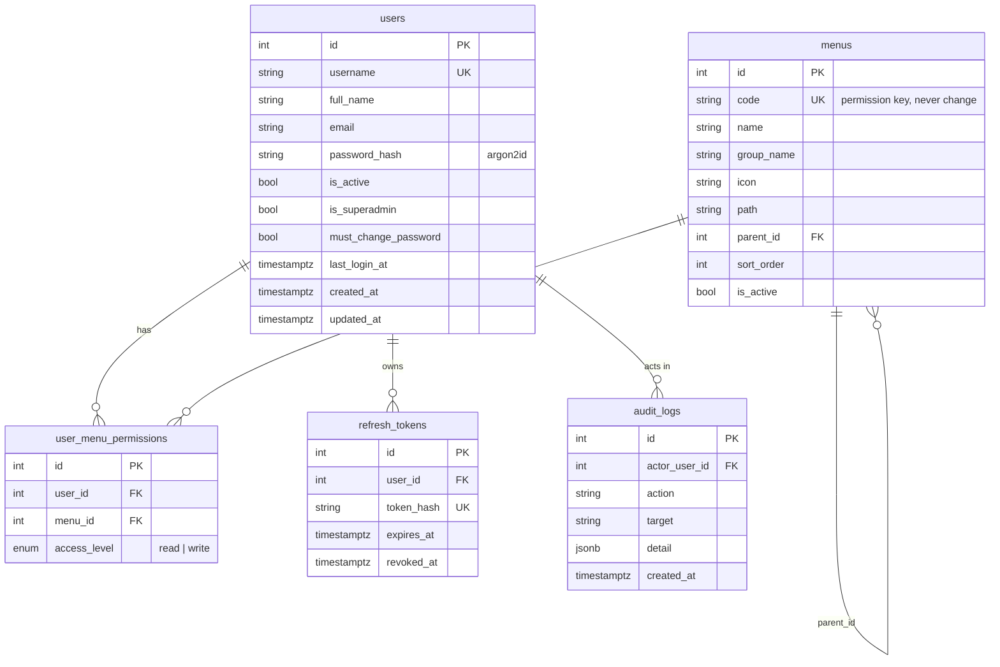

# ERD - Database FlexAdmin (PostgreSQL)

Rules:
- `user_menu_permissions` is unique on (`user_id`, `menu_id`). No row means no access. `write` includes `read`.
- `menus.group_name` is the sidebar group label (not in the original design, added so the sidebar can group menus).
- Every schema change goes through an Alembic migration in `backend/migrations/versions/`.
